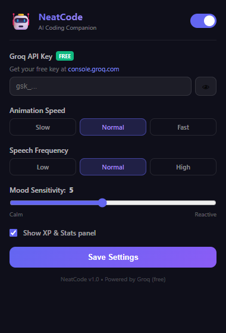

# NeatCode 🤖

Your AI coding companion on LeetCode. Watches your code, reacts emotionally, never spoils the answer.



**How it behaves:** while you code on a LeetCode problem, NeatCode reads your editor, and an animated companion reacts to what you're doing: encouraging when you're close, nudging when you're stuck, celebrating when tests pass. It never writes the solution for you. The popup controls how chatty and reactive it is, and an XP panel tracks your streak.

<br clear="right">

## Install (3 steps)

### 1. Build
```bash
cd neatcode
npm install
npm run build
```

### 2. Load in Chrome
1. Open `chrome://extensions`
2. Enable **Developer mode** (top-right toggle)
3. Click **Load unpacked**
4. Select the `dist/` folder

### 3. Add your free Groq API key
1. Click the NeatCode icon in your Chrome toolbar
2. Go to [console.groq.com](https://console.groq.com) → create free account → copy API key
3. Paste it in the popup → Save

That's it. Open any LeetCode problem and your companion appears bottom-right.

---

## What it does

| Situation | Character |
|-----------|-----------|
| Just started | 🤔 Thinking |
| Making progress | 🙂 Happy |
| Good optimization | 😄 Excited |
| No change | 😐 Neutral |
| Going wrong way | 😟 Worried |
| Repeated mistakes | 😢 Sad |
| Errors everywhere | 😭 Crying |
| Tests pass | 🥳 Celebrating |
| Idle 30s+ | 🥱 Yawning |
| Idle 2min+ | 😴 Sleeping |

## Dev mode (live reload)
```bash
npm run dev
```
Then reload the extension in `chrome://extensions` after changes.

## How the AI works
- Watches Monaco editor every 1.5s, debounces 4s after last keystroke
- Sends only: language, code diff summary, elapsed time, diagnostics
- Never asks AI to solve — only evaluate progress direction
- Falls back to heuristic analysis if no API key

## Tech stack
- Chrome Extension MV3
- React 18 + Zustand
- Vite 5
- Groq API (llama-3.1-8b-instant — free tier)
- Main-world Monaco bridge (content scripts can't see `window.monaco` directly)
